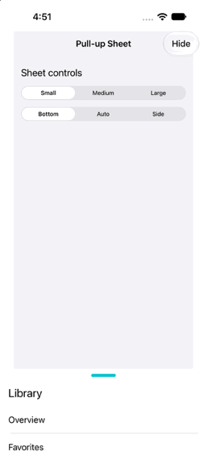

# DKPullUpController

A UIKit child controller for a draggable sheet with configurable snap positions and scroll-view coordination.

## Requirements

- iOS 17 or later
- Swift 5.9 or later
- Xcode 15 or later

## Installation

### Add the package in Xcode

These steps apply to both Swift and Objective-C app targets:

1. In Xcode, choose **File > Add Package Dependencies**.
2. Enter the repository URL:

```text
https://github.com/DineshkumarKandasamy/DKPullUpController
```

3. Select the version or branch you want to use.
4. Add the `DKPullUpController` product to your app target. For Objective-C, select the Objective-C app target as well.
5. Wait for Xcode to resolve and link the package.

### Swift Package Manager manifest

For a project managed with a `Package.swift` manifest, add the package to `dependencies` and the product to your app target's dependencies:

```swift
dependencies: [
    .package(url: "https://github.com/DineshkumarKandasamy/DKPullUpController", from: "1.2.0")
],
targets: [
    .target(
        name: "YourTarget",
        dependencies: [.product(name: "DKPullUpController", package: "DKPullUpController")]
    )
]
```

The version requirement needs a matching release tag in the repository. Then:

1. Import the package in a Swift source file:

   ```swift
   import DKPullUpController
   ```
2. Subclass `DKPullUpController` or instantiate it and configure its content.

### Objective-C target

The package implementation is written in Swift, with an Objective-C-compatible controller API. After adding and linking the package product to your Objective-C app target:

1. Ensure **Build Settings > Enable Modules (CLANG_ENABLE_MODULES)** is `Yes`.
2. Import the module in each Objective-C file that uses the controller:

   ```objc
   @import DKPullUpController;
   ```
3. Instantiate `DKPullUpController`, configure its content and sizing, and add it to a parent controller:

   ```objc
   DKPullUpController *sheet = [DKPullUpController new];
   sheet.pullUpContentView = contentView;
   sheet.pullUpPreferredSize = CGSizeMake(360, 600);
   sheet.pullUpIntermediateSnapPoints = @[@300];
   [sheet addToParent:self initialVisibleHeight:140 animated:YES completion:nil];
   ```

Objective-C clients configure the sheet through its exposed properties and methods; the Swift `configuration` struct is not directly available in Objective-C. See [Objective-C usage](#objective-c) for a complete example.

## Usage

Subclass the controller and provide the sheet's content. A default drag handle is shown at the top of the sheet.

```swift
import DKPullUpController
import UIKit

final class DetailsSheet: DKPullUpController {
    override var preferredPullUpSize: CGSize {
        CGSize(width: 360, height: 600)
    }

    override var middleSnapPoints: [CGFloat] { [300] }
}

let sheet = DetailsSheet()
sheet.configuration.layoutMode = .bottom
sheet.add(to: self, initialVisibleHeight: 140)
```

Visible heights are measured above the configured bottom inset. The initial height, middle points, and preferred height are sorted, deduplicated, and limited to the sheet's height. Safe-area insets are not applied automatically.

Call `move(to:animated:completion:)` to move the sheet, `updatePreferredFrame(animated:)` after changing overridden dimensions, and `remove(animated:completion:)` to remove it. Attach a content view with `attach(scrollView:)`; call `detachScrollView()` when coordination is no longer needed.

For content shorter than the scroll view, set `alwaysBounceVertical = true` on the scroll view if it should still initiate sheet drags.

The default handle is centered at the top of the sheet and does not reserve space for content. It is an adjustable VoiceOver control: swipe up or down to move between snap points. Custom drag handles should provide equivalent accessibility actions. Its appearance can be changed before or after presentation:

```swift
sheet.configuration.defaultDragHandleColor = .systemTeal
sheet.configuration.defaultDragHandleWidth = 48
sheet.configuration.defaultDragHandleHeight = 6
sheet.configuration.defaultDragHandleCornerRadius = 3
sheet.configuration.defaultDragHandleTopInset = 10
```

Set `showsDefaultDragHandle` to `false` to hide it. The sheet's own pan gesture starts on its root view. Use `setDragHandleView(_:)` to hide the default handle and restrict the gesture to a custom descendant, or pass `nil` to return to the configured default handle and the root-view gesture. The gesture is available as `pullUpPanGestureRecognizer` after the view loads; keep its delegate and target intact.

An optional built-in blur can be enabled behind the sheet content:

```swift
sheet.configuration.isBackgroundBlurEnabled = true
sheet.configuration.backgroundBlurStyle = .systemThinMaterial
```

The blur is off by default. A custom `pullUpContentView` drawn over it should have a transparent background where the blur should show through.

An optional background-card effect scales the parent screen as the sheet rises. It is off by default:

```swift
sheet.configuration.isBackgroundCardEffectEnabled = true
sheet.configuration.backgroundCardScale = 0.9
sheet.configuration.backgroundCardVerticalOffset = 24
sheet.configuration.backgroundCardCornerRadius = 24
sheet.configuration.backgroundCardContentMode = .live
```

In `.live` mode, the parent's content scales while its controls remain interactive at their visible positions and the sheet stays fixed. `.snapshot` scales a captured image instead and blocks touches outside the sheet until it is removed.

When Reduce Motion is enabled, sheet transitions are immediate and background-card scaling, translation, and corner-radius effects are suppressed.

## Objective-C

Import the package module and provide the sheet's content view and sizing in Objective-C:

```objc
@import DKPullUpController;

DKPullUpController *sheet = [DKPullUpController new];
UIView *contentView = [[UIView alloc] init];
contentView.backgroundColor = UIColor.secondarySystemBackgroundColor;
sheet.pullUpContentView = contentView;
sheet.pullUpPreferredSize = CGSizeMake(360, 600);
sheet.pullUpIntermediateSnapPoints = @[@300];
sheet.layoutMode = DKPullUpLayoutModeBottom;
sheet.pullUpDefaultDragHandleColor = UIColor.systemTealColor;
sheet.isBackgroundBlurEnabled = YES;
sheet.backgroundBlurStyle = DKPullUpBackgroundBlurStyleSystemThinMaterial;
sheet.isBackgroundCardEffectEnabled = YES;
sheet.backgroundCardScale = 0.9;
sheet.backgroundCardVerticalOffset = 24;
sheet.backgroundCardCornerRadius = 24;
sheet.backgroundCardContentMode = DKPullUpBackgroundCardContentModeLive;
[sheet addToParent:self initialVisibleHeight:140 animated:YES completion:nil];
```

`configuration` remains the Swift configuration value. Objective-C code can configure its settings through the controller's matching properties, including `layoutMode`, `horizontalAlignment`, `horizontalOffset`, `bottomInset`, the drag and snapping options, and animation durations. Drag-handle settings use the `pullUpDefaultDragHandle...` property prefix. The preferred side frame is set with `pullUpPreferredLandscapeFrame`; current snap positions are available through `pullUpSnapPoints`.

The controller's `moveToVisibleHeight:animated:completion:`, `removeAnimated:completion:`, `attachScrollView:`, and `detachScrollView` methods are also available. Objective-C clients configure the controller by composition; customize override hooks in a Swift subclass when behavior beyond the exposed settings is needed.

## Configuration

`DKPullUpConfiguration` contains the layout, gesture, drag-handle, and animation settings. Assign it before or after adding the sheet; changes are applied to a loaded sheet.

```swift
var configuration = DKPullUpConfiguration()
configuration.layoutMode = .bottom
configuration.horizontalAlignment = .trailing
configuration.horizontalOffset = 12
configuration.bottomInset = 20
configuration.isDraggingEnabled = true
configuration.isScrollDraggingEnabled = true
configuration.isSnappingEnabled = true
configuration.allowsScrollDragBounce = false
configuration.maximumNumberOfTouches = 1
configuration.showsDefaultDragHandle = true
configuration.isBackgroundBlurEnabled = true
configuration.backgroundBlurStyle = .systemThinMaterial
configuration.isBackgroundCardEffectEnabled = true
configuration.backgroundCardScale = 0.9
configuration.backgroundCardVerticalOffset = 24
configuration.backgroundCardCornerRadius = 24
configuration.backgroundCardBackdropColor = .systemBackground
configuration.backgroundCardContentMode = .live
configuration.defaultDragHandleColor = .systemTeal
configuration.defaultDragHandleWidth = 48
configuration.defaultDragHandleHeight = 6
configuration.defaultDragHandleCornerRadius = 3
configuration.defaultDragHandleTopInset = 10
configuration.presentationDuration = 0.3
configuration.dismissalDuration = 0.3
configuration.movementDuration = 0.3
configuration.minimumSnapDuration = 0.08
configuration.maximumSnapDuration = 0.3
configuration.usesVelocityForSnapDuration = true
configuration.scrollTopTolerance = 0.5

sheet.configuration = configuration
```

### Configuration properties

| Property | Default | Description |
| --- | --- | --- |
| `layoutMode` | `.automatic` | `.automatic` uses side layout when the parent is wider than tall; otherwise it uses bottom layout. `.bottom` and `.side` force a layout. Side layout uses `preferredLandscapeFrame` and disables dragging. |
| `horizontalAlignment` | `.center` | Bottom-layout alignment: `.leading`, `.center`, or `.trailing`. Leading/trailing respect right-to-left layout direction. |
| `horizontalOffset` | `0` | Horizontal position offset in points. Edge-aligned offsets move inward; centered offsets move right. |
| `bottomInset` | `0` | Distance above the parent's bottom edge used as the sheet's reference edge. Safe-area insets are not applied automatically. |
| `isDraggingEnabled` | `true` | Enables the sheet's own pan gesture. |
| `isScrollDraggingEnabled` | `true` | Enables dragging the sheet through an attached scroll view. |
| `isSnappingEnabled` | `true` | Settles at a snap point after a drag. When disabled, the sheet remains at its bounded release height. |
| `allowsScrollDragBounce` | `false` | Allows scroll-driven drags to extend beyond the snap range by `bounceOffset`. |
| `maximumNumberOfTouches` | `1` | Maximum touches accepted by the sheet pan gesture. Values below one are treated as one. |
| `showsDefaultDragHandle` | `true` | Shows the built-in handle when a custom handle has not been selected. |
| `isBackgroundBlurEnabled` | `false` | Enables the built-in blur behind the sheet content. A custom content view must be transparent where the blur should show through. |
| `backgroundBlurStyle` | `.systemMaterial` | Blur material: `.systemUltraThinMaterial`, `.systemThinMaterial`, `.systemMaterial`, `.systemThickMaterial`, `.systemChromeMaterial`, `.light`, or `.dark`. Used when background blur is enabled. |
| `isBackgroundCardEffectEnabled` | `false` | Scales and rounds the parent screen as the sheet rises; these effects are suppressed when Reduce Motion is enabled. |
| `backgroundCardScale` | `0.9` | Scale of the background card at the sheet's maximum height. Values outside `(0, 1]` use `1`. |
| `backgroundCardVerticalOffset` | `24` | Vertical translation in points at the sheet's maximum height; positive values move down. |
| `backgroundCardCornerRadius` | `24` | Corner radius, in points, at the sheet's maximum height. Negative and non-finite values become zero. |
| `backgroundCardBackdropColor` | `.systemBackground` | Color visible around the scaled background card. |
| `backgroundCardContentMode` | `.live` | `.live` scales the parent's content while keeping its controls interactive and aligned; `.snapshot` scales a captured image and blocks touches outside the sheet. |
| `defaultDragHandleColor` | `.tertiaryLabel` | Built-in handle color. |
| `defaultDragHandleWidth` | `40` | Built-in handle width in points. Negative and non-finite values become zero. |
| `defaultDragHandleHeight` | `5` | Built-in handle height in points. Negative and non-finite values become zero. |
| `defaultDragHandleCornerRadius` | `2.5` | Built-in handle corner radius in points. Negative and non-finite values become zero. |
| `defaultDragHandleTopInset` | `10` | Distance from the sheet's top edge to the built-in handle. Negative and non-finite values become zero. |
| `presentationDuration` | `0.3` | Presentation animation duration in seconds; transitions are immediate when Reduce Motion is enabled. |
| `dismissalDuration` | `0.3` | Dismissal animation duration in seconds; transitions are immediate when Reduce Motion is enabled. |
| `movementDuration` | `0.3` | Duration for programmatic moves and preferred-frame updates; transitions are immediate when Reduce Motion is enabled. |
| `minimumSnapDuration` | `0.08` | Minimum release-animation duration in seconds, limited to `maximumSnapDuration`. |
| `maximumSnapDuration` | `0.3` | Maximum release-animation duration in seconds. |
| `usesVelocityForSnapDuration` | `true` | Calculates release duration from distance and speed. When disabled, the maximum duration is used. |
| `scrollTopTolerance` | `0.5` | Allowance in points when deciding whether an attached scroll view is at its adjusted top. |

Objective-C uses matching properties on `DKPullUpController` instead of the Swift-only `configuration` struct:

```objc
sheet.layoutMode = DKPullUpLayoutModeBottom;
sheet.horizontalAlignment = DKPullUpHorizontalAlignmentTrailing;
sheet.horizontalOffset = 12;
sheet.bottomInset = 20;
sheet.isDraggingEnabled = YES;
sheet.isScrollDraggingEnabled = YES;
sheet.isSnappingEnabled = YES;
sheet.allowsScrollDragBounce = NO;
sheet.maximumNumberOfTouches = 1;
sheet.showsDefaultDragHandle = YES;
sheet.isBackgroundBlurEnabled = YES;
sheet.backgroundBlurStyle = DKPullUpBackgroundBlurStyleSystemThinMaterial;
sheet.isBackgroundCardEffectEnabled = YES;
sheet.backgroundCardScale = 0.9;
sheet.backgroundCardVerticalOffset = 24;
sheet.backgroundCardCornerRadius = 24;
sheet.backgroundCardBackdropColor = UIColor.systemBackgroundColor;
sheet.backgroundCardContentMode = DKPullUpBackgroundCardContentModeLive;
sheet.pullUpDefaultDragHandleColor = UIColor.systemTealColor;
sheet.pullUpDefaultDragHandleWidth = 48;
sheet.pullUpDefaultDragHandleHeight = 6;
sheet.pullUpDefaultDragHandleCornerRadius = 3;
sheet.pullUpDefaultDragHandleTopInset = 10;
sheet.presentationDuration = 0.3;
sheet.dismissalDuration = 0.3;
sheet.movementDuration = 0.3;
sheet.minimumSnapDuration = 0.08;
sheet.maximumSnapDuration = 0.3;
sheet.usesVelocityForSnapDuration = YES;
sheet.scrollTopTolerance = 0.5;
```

### Sheet sizing and snap options

These are subclass overrides in Swift. In Objective-C, use the corresponding `pullUp...` properties when configuring a controller instance.

```swift
final class DetailsSheet: DKPullUpController {
    override var preferredPullUpSize: CGSize {
        CGSize(width: 360, height: 600)
    }

    override var preferredLandscapeFrame: CGRect {
        CGRect(x: 24, y: 24, width: 360, height: 700)
    }

    override var middleSnapPoints: [CGFloat] { [280, 420] }
    override var bounceOffset: CGFloat { 40 }
    override var skipPointVelocity: CGFloat { 700 }
}
```

| Swift customization | Default | Objective-C property | Description |
| --- | --- | --- | --- |
| `preferredPullUpSize` | Parent width by `400` points | `pullUpPreferredSize` | Bottom-layout size. Width is limited to the parent; height is the maximum snap height. |
| `preferredLandscapeFrame` | 16-point inset; width at most `360` | `pullUpPreferredLandscapeFrame` | Side-layout frame in parent coordinates. Side layout disables dragging. |
| `middleSnapPoints` | `[]` | `pullUpIntermediateSnapPoints` | Additional visible heights, excluding the initial and maximum heights. Values are bounded, sorted, and deduplicated. |
| `bounceOffset` | `0` | No Objective-C property | Extra drag distance beyond the snap range. Scroll-driven drags use it only when `allowsScrollDragBounce` is enabled. |
| `skipPointVelocity` | `700` points/second | No Objective-C property | Absolute release speed above which the default target selection projects the release position. |

The initial snap height is passed to `add(to:initialVisibleHeight:animated:completion:)`. The initial height, `middleSnapPoints`, and preferred height are combined into `snapPoints`; non-finite values are excluded, and positions are bounded, sorted, and deduplicated. Call `updatePreferredFrame(animated:)` after changing overridden sizes or snap points. `pullUpSnapPoints` exposes the same positions as `NSNumber` values to Objective-C.

### Interaction and animation hooks

Override these methods in a Swift subclass to observe or customize behavior:

```swift
final class CustomSheet: DKPullUpController {
    override func pullUpWillMove(to visibleHeight: CGFloat) {
        print("Moving to \(visibleHeight)")
    }

    override func pullUpDidMove(to visibleHeight: CGFloat) { }
    override func pullUpDidDrag(to visibleHeight: CGFloat) { }

    override func targetSnapPoint(
        for visibleHeight: CGFloat, velocity: CGFloat, points: [CGFloat]
    ) -> CGFloat {
        points.min(by: { abs($0 - visibleHeight) < abs($1 - visibleHeight) }) ?? visibleHeight
    }

    override func snapAnimationDuration(
        from visibleHeight: CGFloat, to target: CGFloat, velocity: CGFloat
    ) -> TimeInterval {
        0.2
    }

    override func shouldReceivePullUpTouch(_ touch: UITouch) -> Bool {
        true
    }

    override func shouldDragPullUp(from scrollView: UIScrollView, translation: CGFloat) -> Bool {
        translation < 0 || scrollView.contentOffset.y <= -scrollView.adjustedContentInset.top
    }
}
```

The additional overridable methods are `animatePullUp(action:duration:animations:completion:)` for custom presentation, dismissal, and movement animations. An override must perform `animations` and call `completion` when supplied, including for a zero-duration request. Objective-C clients can call the exposed configuration and controller methods, but cannot subclass this Swift controller; use a Swift subclass when custom override behavior is needed.

`visibleHeight`, `snapPoints`, and `pullUpPanGestureRecognizer` are read-only state. The pan recognizer is available after the view loads; keep its existing target and delegate intact. Use `setDragHandleView(_:)` to move it to a descendant view, or pass `nil` to restore the default root-view gesture. Use `attach(scrollView:)` and `detachScrollView()` to coordinate scrolling. For short scroll content that should still initiate sheet drags, set `alwaysBounceVertical = true`.

All controller operations must run on the main actor.

## Example

Open [DKPullUpExample.xcodeproj](Example/DKPullUpExample.xcodeproj) and choose either the `DKPullUpExample` (Swift) or `DKPullUpObjCExample` (Objective-C) scheme. Both targets reference this package locally. A physical device requires a signing team configured in Xcode.



## License

Distributed under the [MIT license](LICENSE).
